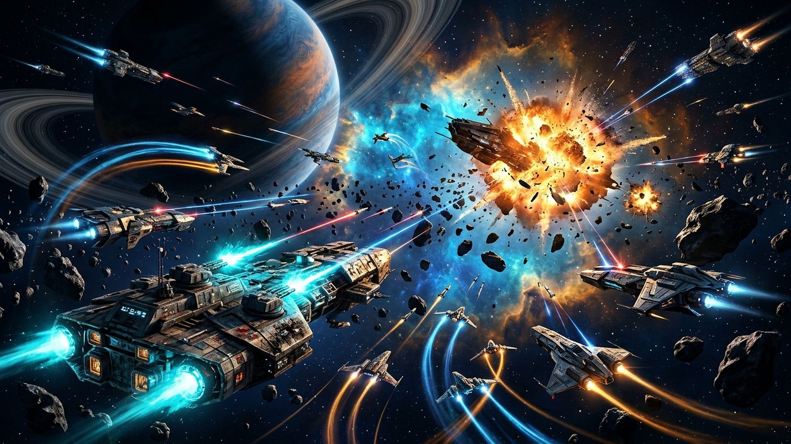
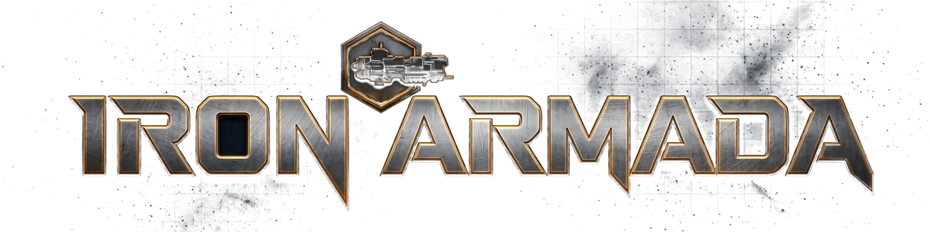
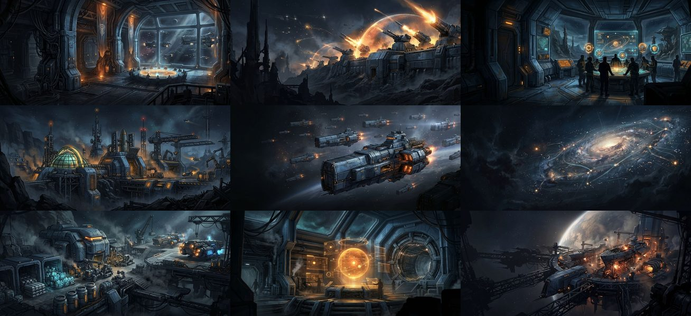
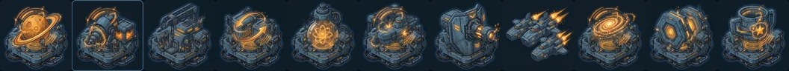

<p align="center"></p>

<p align="center"></p>

<p align="center"><strong>A self-hosted, browser-based space strategy MMO.</strong><br/>Build an economy, research technology, command fleets and fight for the top of the highscore.</p>

<p align="center">
<a href="#whats-new">What's new</a> • <a href="#features">Features</a> • <a href="#installation">Installation</a> • <a href="#upgrading">Upgrading</a> • <a href="#admin">Admin</a> • <a href="#public-highscore-feed">Highscore API</a>
</p>

<p align="center"></p>

Iron Armada is a private fork of [OGameX](https://github.com/lanedirt/OGameX), the open-source Laravel recreation of OGame, re-skinned and extended into its own game by Archon Tech. The strategy engine (planets, buildings, research, fleets, battles, moons, alliances) comes from OGameX. Everything on top of that is ours: a new visual identity, computer-controlled empires, pirate raids, daily directives, Discord integration, a mobile layout and a public highscore feed.

Stack: Laravel (PHP 8.5), Blade + legacy jQuery front end, Vite, MariaDB, Laravel Reverb (websockets), queue worker and scheduler, optional Rust battle engine. Runs in Docker and is published through a Cloudflare Tunnel.

## <a name="whats-new"></a>What's new

Latest first. Full history is in the commit log.

**Art pass and UI**
- Custom art for every page: banners for Facilities, Research, Shipyard, Defence, Fleet, Galaxy, Alliance, Merchant and Directives; menu icons; class and alliance-class emblems; moon, debris-field and missile icons; planet thumbnails for every biome; building, ship, defence and research tiles; resource and mission icons.
- Chamfered panels with amber HUD corner brackets and angled title plates, tile state rings (available / building / locked), planet list hover states, vignette and polished buttons.
- New logo, favicons and login page.

**Gameplay**
- **Bots (NPC empires):** computer-controlled players with economy, research and fleet logic, difficulty levels and personalities. They colonise free slots and raid clearly weaker bots. Bot names end in `(NPC)`.
- **Pirate raids:** a raid-only bot personality that attacks with a fleet sized relative to the target, so raids are beatable. Protection rules are configurable: never admins, banned or vacation players, accounts under N days old or N points; per-target cooldown; daily raid cap; global on/off.
- **Directives:** daily and weekly objectives (building and research gains, missions launched) that pay dark matter, claimable once per period.
- **Queue as many as you can afford:** building and research queues accept every item you can pay for.
- **Options page:** interface preferences are stored per player (autofocus, animations, popups, sort order, results per page and more) and the dropdowns work.

**Platform**
- **Mobile layout:** responsive in-game shell and card-style Galaxy view.
- **Discord:** new-player and pirate-raid notifications and exception alerts via a webhook that is set in Admin > Server Settings (stored in the database, never in the repo).
- **Public highscore feed:** read-only JSON leaderboard for external sites, see [below](#public-highscore-feed).
- **Cleanup:** dead premium, shop, payment and officer pages removed; dead outgame links fixed; Iron Armada copy and welcome message.
- **Hardening:** build, research and unit requests with a missing CSRF token now answer with a normal error instead of a server exception.

## <a name="features"></a>Features

Core game (inherited from OGameX, and still fully tested):

- Planets, buildings, research, shipyard, defence, galaxy, highscores, messages
- Fleet missions: transport, deployment, colonisation, espionage, attack, ACS, recycle, expedition, moon destruction, missile attacks
- Battle engine in Rust (via PHP FFI, up to ~200x faster) with a PHP fallback
- Moons with phalanx and jump gate, debris fields, wreck fields and Space Dock
- Character classes, alliances (with alliance classes), buddies, notes, fleet templates, in-game chat
- Dark matter features (non-commercial): merchant and planet relocation
- Admin panel, multi-language

Iron Armada additions: bots, pirates, directives, Discord notifications, mobile layout, public highscore feed, new art and UI (see above).

<p align="center"></p>

## <a name="installation"></a>Installation

Iron Armada runs in Docker. The first start can take up to 10 minutes (Composer install and Rust compile).

```bash
git clone https://github.com/NinjaInc/IronArmada.git
cd IronArmada

# production
cp .env.example-prod .env        # then edit .env: APP_URL, database passwords, Reverb and Discord settings
docker compose -f docker-compose.prod.yml up -d --build --force-recreate

# development
docker compose up -d
```

The first account you register is made an admin. Production runs in forced-HTTPS mode with a self-signed certificate by default; in our deployment TLS is terminated by the Cloudflare Tunnel in front of it. Change the default database passwords before going live.

Assets are compiled with Vite and the build output in `public/build` is tracked in git. After changing CSS or JS run `npm run build` and commit the result.

## <a name="upgrading"></a>Upgrading

```bash
git pull origin main
docker compose -f docker-compose.prod.yml up -d --build --force-recreate --remove-orphans
```

The entrypoint runs database migrations and refreshes caches on start. If you cache routes, clear them (`php artisan route:clear`) so new routes are picked up. Ask players to hard-refresh after a UI update.

## <a name="admin"></a>Admin

- Make someone an admin: `docker compose exec ogamex-app php artisan ogamex:admin:assign-role {username}` (remove with `ogamex:admin:remove-role`). Add `-f docker-compose.prod.yml` for production.
- **Server Settings:** game speed and rules, the Discord webhook URL (masked once saved) and more.
- **Bots:** enable bots and pirates, set difficulty, protection rules and raid caps, and see activity stats and the recent raid log.

## <a name="public-highscore-feed"></a>Public highscore feed

A read-only leaderboard for external websites. No login, rate limited to 60 requests per minute, cached for 5 minutes.

```
GET /api/public/highscores
```

```json
{
  "game": "Iron Armada",
  "players": 7,
  "updated_at": "2026-11-15T04:30:00+00:00",
  "categories": {
    "general":  [ { "rank": 1, "name": "...", "alliance": "TAG or null", "points": 123, "bot": false } ],
    "economy":  [ "..." ],
    "research": [ "..." ],
    "military": [ "..." ]
  }
}
```

Each category lists up to 10 entries. Admin accounts and Legor are always excluded, bots are included with `"bot": true`, and no emails, IDs or coordinates are exposed. The contract is relied on by the xLAx website, so treat it as stable.

## Development

Run everything through Docker, for example `docker compose run --rm ogamex-app <command>`. After code changes run, in order: `composer run rector`, `composer run cs`, `composer run stan`, `composer run tests`. Schema changes go in new migrations, never edit a merged one. See [CONTRIBUTING.md](CONTRIBUTING.md) and [AGENTS.md](AGENTS.md).

## Credits and licence

- Iron Armada is built on [OGameX](https://github.com/lanedirt/OGameX) by [@lanedirt](https://github.com/lanedirt) and its contributors, licensed under the MIT licence (see [LICENSE](LICENSE)). Their work is the foundation of this game.
- Iron Armada additions and art: Archon Tech.
- Disclaimer: this is a non-commercial fan project. The concepts and rights for OGame belong to GameForge GmbH; support the official game at https://ogame.org.
